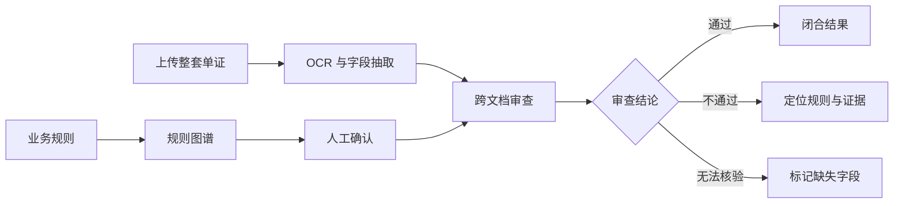
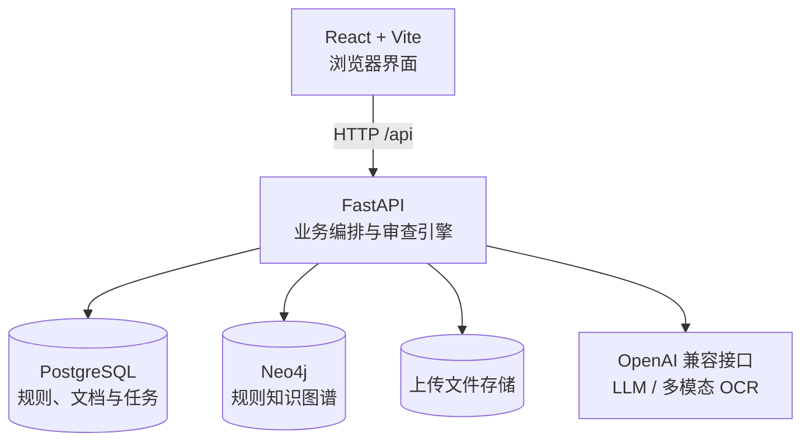

<p align="center">
  
</p>

<h1 align="center">DocGraph · 智图审</h1>

<p align="center">
  <strong>把贸易单证审查，从人工翻找升级为可追溯的图谱推理。</strong>
</p>

<p align="center">
  上传一整套业务单证，自动完成 OCR 与字段抽取，再依据可配置的规则图谱进行跨文档核验。
</p>

<p align="center">
  <a href="#快速开始"></a>
  
  
  
  
</p>

<p align="center">
  <a href="#项目亮点">项目亮点</a> ·
  <a href="#工作原理">工作原理</a> ·
  <a href="#快速开始">快速开始</a> ·
  <a href="#docker-部署">Docker 部署</a> ·
  <a href="#项目文档">项目文档</a>
</p>

> **项目状态：MVP。** 当前版本聚焦核心审查链路，内置服务暂不包含登录、权限和租户隔离，请勿将 API 直接暴露到公网。

## 项目亮点

| 亮点 | 与传统“逐份检查”相比，DocGraph 做了什么 |
| --- | --- |
| **规则即图谱** | 把单证、字段和业务约束建模成 Neo4j 图谱，由 `REQUIRED`、`MUST_STAMP`、`COMPARE_TO` 等关系驱动审查，而不是把业务规则硬编码在页面里。 |
| **跨单证核验** | 不只看一份文件是否“填对”，还检查发票、报关单、委托单、协议等材料之间的金额、日期、重量和齐套性。 |
| **结论可追溯** | 每条结果都回到具体规则、比对字段和源单证，便于审查员复核，而不是只给出一个无法解释的风险标签。 |
| **业务规则可配置** | 支持多规则集、文档类型管理和规则文档导入；不同贸易场景可以使用各自的规则、图谱和审查结果。 |
| **三态审查结果** | 区分 **通过 / 不通过 / 无法核验**。数据缺失时不会强行判错，帮助团队优先处理真正有把握命中问题的单据。 |
| **端到端可运行** | React 前端、FastAPI 后端、PostgreSQL、Neo4j、OCR 和 LLM 全部打通，同时提供本地开发与 Docker 单机部署方案。 |

## 工作原理



一个典型场景中，DocGraph 可以同时检查：

- 发票金额是否在约定容差内等于报关单总价；
- 委托单签订日期是否不晚于报关单申报日期；
- 当前业务批次是否缺少必备单证；
- 需要盖章的材料是否检测到印章。

## 功能地图

- **规则集管理**：按业务场景隔离规则、文档和审查结果。
- **文档类型**：维护文件分类、关键字段和别名。
- **规则导入**：支持从规则文档整理结构化检查项。
- **图谱确认**：将规则构建成图，并在审查前检查节点和关系。
- **批量识别**：处理 PDF、PNG、JPG/JPEG 和 DOCX。
- **审查执行**：并发处理 OCR 与审查任务，回收中断任务。
- **结果展示**：呈现三态结果、规则说明和原始单证证据。
- **版本核验**：对比前后端构建版本和运行提交，降低“部署了旧代码”的风险。

## 系统架构



| 模块 | 技术 |
| --- | --- |
| 前端 | React 18、TypeScript、Vite、Ant Design、D3.js |
| 后端 | Python 3.12、FastAPI、SQLAlchemy |
| 数据 | PostgreSQL 16、Neo4j 5.26 Community |
| 文档处理 | pdfplumber、PyMuPDF、Pillow、python-docx、RapidOCR |
| 智能服务 | 任意 OpenAI 兼容的 LLM 与多模态 OCR 接口 |
| 部署 | Docker Compose、nginx |

## 快速开始

### 环境要求

- Python 3.12
- Node.js 22 与 npm
- Docker Desktop 或 Docker Engine（支持 `docker compose`）
- 可用的 OpenAI 兼容 LLM/OCR 服务及 API Key

### 1. 克隆并配置

```powershell
git clone https://github.com/BroTen10/DocGraph.git
Set-Location DocGraph
Copy-Item backend\.env.example backend\.env
```

编辑 `backend\.env`，至少填写 `LLM_API_KEY`。OCR 未单独配置时会复用该 Key。

### 2. 启动数据库

```powershell
docker compose --env-file backend\.env up -d postgres neo4j
```

### 3. 启动后端

```powershell
Set-Location backend
py -3.12 -m venv .venv
.\.venv\Scripts\python.exe -m pip install -r requirements.txt
.\.venv\Scripts\python.exe run.py
```

后端 API：<http://localhost:8800>  
接口文档：<http://localhost:8800/docs>

### 4. 启动前端

另开一个终端：

```powershell
Set-Location frontend
npm ci
npm run dev
```

打开 <http://localhost:5173>。首次进入后先创建规则集，再添加文档类型和审查规则。

> 完成首次依赖安装后，也可以在仓库根目录运行 `start_services.bat` 同时启动前后端。

## Docker 部署

面向 Linux 单机环境：

```bash
git clone https://github.com/BroTen10/DocGraph.git
cd DocGraph
cp backend/.env.example backend/.env
vi backend/.env
bash deploy.sh
```

默认访问地址为 <http://localhost:8080>。部署脚本会构建前后端镜像、启动数据库并完成健康检查。

```bash
bash deploy.sh check      # 部署后自检
bash deploy.sh status     # 查看容器状态
bash deploy.sh logs       # 查看日志
bash deploy.sh restart    # 重启服务
bash deploy.sh down       # 停止服务
```

完整说明见 [Docker 单机部署文档](docs/部署-Docker单机部署.md)。

## 常用配置

配置集中在 `backend\.env`：

| 配置 | 默认值 | 说明 |
| --- | --- | --- |
| `LLM_API_KEY` | 空 | LLM/OCR 服务密钥，必填 |
| `LLM_BASE_URL` | OpenAI 兼容地址 | 模型接口 |
| `LLM_MODEL_NAME` | `deepseek-v4.1-flash` | 审查与抽取模型 |
| `UPLOAD_ROOT` | `./uploads` | 原始单证存储目录 |
| `MAX_FILE_SIZE_MB` | `50` | 单文件大小上限 |
| `AMOUNT_TOLERANCE_PERCENT` | `5` | 金额比较容差 |
| `WEIGHT_TOLERANCE_KG` | `0.5` | 重量比较容差 |
| `LLM_CONFIDENCE_THRESHOLD` | `0.9` | 规则转图谱自动确认阈值 |
| `DB_RESET_ON_STARTUP` | `false` | 是否清空并重建数据 |

> `DB_RESET_ON_STARTUP=true` 会删除业务数据并清空图谱，只能用于确认可以丢弃数据的隔离环境。

## 测试

部分图谱测试需要 PostgreSQL 和 Neo4j 已启动：

```powershell
backend\.venv\Scripts\python.exe tests\run_graph_rule_tests.py
```

以下测试无需数据库或网络：

```powershell
backend\.venv\Scripts\python.exe tests\test_llm_client.py
backend\.venv\Scripts\python.exe tests\test_version.py
backend\.venv\Scripts\python.exe tests\test_rule_import_granularity.py
backend\.venv\Scripts\python.exe tests\test_missing_data_tristate.py
```

测试范围和扩展方式见 [tests/README.md](tests/README.md)。

## 目录结构

```text
DocGraph/
├── backend/                 FastAPI API、审查服务、OCR 与图谱逻辑
├── frontend/                React 管理界面
├── docs/                    架构、部署与版本管理文档
├── tests/                   图谱、规则导入、版本和三态结果测试
├── docgraph-brand/          项目图标与品牌素材
├── docker-compose.yml       本地数据库及生产服务编排
├── deploy.sh                Linux 单机部署脚本
├── LICENSE                  MIT License
└── THIRD-PARTY-NOTICES.md   第三方组件许可声明
```

## 安全提示

- 当前 API 没有身份认证和权限控制，请在受控网络或 VPN 中使用。
- 生产环境只应通过前端入口访问服务，并为入口配置 HTTPS。
- `backend/.env`、上传的真实单证和数据库卷包含敏感信息，不应提交到 Git。
- 对外服务前应补充访问控制、审计日志、资源限制和备份策略。

## 开源许可

DocGraph 仓库自身采用 [MIT License](LICENSE)，允许使用、修改、分发和商用，但分发时需保留原版权声明与许可声明。

第三方依赖遵循各自的许可证。需要特别评估的组件包括 PyMuPDF（AGPL-3.0 或商业授权）、Neo4j Community（GPL-3.0）和 psycopg2-binary（LGPL-3.0 及链接例外）。如计划分发或作为网络服务运营，请阅读 [THIRD-PARTY-NOTICES.md](THIRD-PARTY-NOTICES.md)。

## 项目文档

- [Docker 单机部署](docs/部署-Docker单机部署.md)
- [版本管理](docs/版本管理.md)
- [规则解析控制架构设计](docs/规则解析控制架构设计.md)
- [泛化规则体系重构设计](docs/泛化规则体系重构设计.md)
- [第三方组件声明](THIRD-PARTY-NOTICES.md)

---

<p align="center">
  如果 DocGraph 的思路对你有帮助，欢迎 Star 或提交 Issue。
</p>
