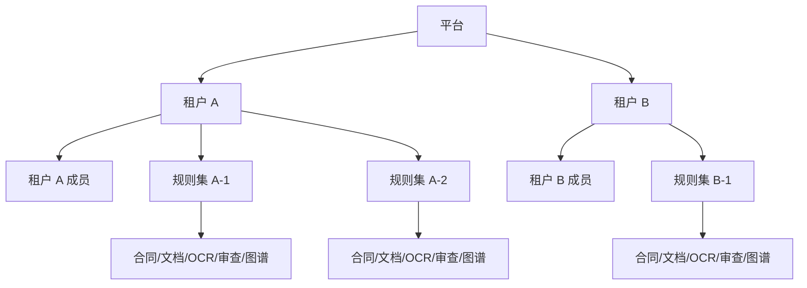
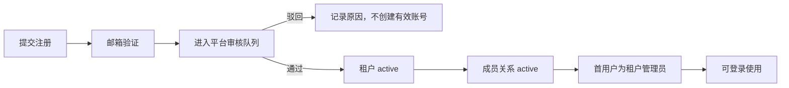

# 登录、权限与多租户隔离需求设计

| 项目 | 内容 |
| --- | --- |
| 文档版本 | v1.0 |
| 设计日期 | 2026-10-24 |
| 文档状态 | 需求基线，可进入技术设计和任务拆分 |
| 适用版本 | 文档审查核心链路完成后的 SaaS 化版本 |

## 1. 结论摘要

本任务不是简单增加一个登录页和隐藏菜单，而是把当前单租户、匿名访问的系统升级为具备账号体系、角色权限和数据安全边界的多租户系统。

本设计确定以下核心口径：

1. 租户是**安全隔离边界**；规则集只是租户内部的**业务组织单元**，不能单独承担租户隔离。
2. 新组织采用“自助注册 + 平台管理员审核”的方式开通，首个注册用户成为该租户的租户管理员。
3. 已有租户新增成员采用“租户管理员邀请”的方式，避免用户自行加入其他组织。
4. 所有用户必须使用邮箱登录、填写中国大陆手机号；手机号只校验格式，本期不发送短信、不做实名认证。
5. 租户内使用固定角色：租户管理员、审查员、只读查看者。首版不在界面上自由拼接权限点。
6. 系统设置菜单仅租户管理员可见；普通用户即使手工访问路由或直接调用 API，也必须被拒绝。
7. 租户归属只能由服务端根据登录会话和成员关系得出，不能信任前端传入的 `tenant_id`。
8. 租户隔离必须覆盖 PostgreSQL、上传文件、后台任务、Neo4j 图谱、系统设置、下载和导出，不只覆盖页面列表。
9. 平台管理员负责租户审核和平台级运维，默认不能浏览租户业务单证；未来如提供客服代操作能力，必须采用有审批、有时限的“临时访问”，不能静默跨租户访问。
10. 存量数据统一归入“默认租户”，上线前必须完成账号、租户字段、唯一约束、文件和图谱的兼容迁移，并验证回滚方案。

## 2. 背景与现状

### 2.1 当前能力

当前版本聚焦文档上传、OCR、规则管理、图谱构建、审查执行和结果展示。系统已经具备以下基础：

- `RuleSet` 可以把规则、合同、文档、图谱和审查任务按业务场景分开。
- `contracts`、`rules`、`ocr_tasks`、`review_tasks` 等表已经携带 `rule_set_id`。
- 前端已有规则集切换器和系统设置页。
- Docker 部署下前后端同源，适合采用 HttpOnly Cookie 会话。

### 2.2 当前缺口

根据现有代码，当前版本存在以下安全前置问题：

- 所有业务 API 均没有身份认证依赖，包括删除规则集、下载原始文件、修改审查结果和更新系统设置。
- `RuleSet.name` 是全局唯一，`DocumentType.name` 也是全局唯一，不能直接表达不同租户的同名资源。
- `system_settings` 目前是全局设置，没有租户维度。
- 上传文件按合同号或规则集组织，未形成租户级目录边界。
- 多个接口通过对象 ID 直接读取对象，例如文档、任务、快照和图谱；仅靠 `rule_set_id` 查询参数不能防止对象 ID 猜测。
- Neo4j 节点只按 `graph_id` 区分，尚未写入租户属性。
- 规则导入任务和图谱构建进度目前主要在进程内维护，任务列表没有租户过滤条件。
- 前端 `App.tsx` 的菜单是静态配置，当前用户信息也是固定文案，无法根据权限动态展示。
- 文件下载接口需要直接返回原文件，必须在读取文件前完成对象级鉴权。

因此，本期必须同时改造认证、权限、数据模型和资源访问路径。只增加前端菜单隐藏或只增加 `tenant_id` 查询参数都不满足安全要求。

## 3. 目标和范围

### 3.1 本期目标

- 支持邮箱注册、邮箱验证、平台管理员审核后开通租户。
- 支持邮箱密码登录、退出、会话续期、忘记密码、修改密码和账号锁定。
- 强制维护中国大陆手机号，统一格式校验与存储。
- 支持租户管理员邀请、审核、启用、停用和调整本租户成员角色。
- 支持租户管理员、审查员、只读查看者和平台管理员四类身份。
- 仅租户管理员看到系统设置菜单，并在其中管理本租户用户和权限。
- 完成业务数据的租户归属、服务端鉴权、对象级越权防护和存量迁移。
- 对租户、用户、权限和审核操作保留可追溯审计日志。

### 3.2 本期不做

- 短信验证码和手机号真实性验证。
- 身份证、企业工商信息或其他实名认证。
- 多因素认证、企业微信/钉钉/SSO 登录。
- 自定义角色和逐权限点勾选。
- 一个账号同时加入多个租户并在租户间切换。
- 跨租户共享规则集、文档、图谱或审查结果。
- 平台管理员无感切换为租户用户。
- 计费、套餐、配额购买和组织域名自动认证。
- 独立数据库或独立 schema 的物理租户隔离。

上述能力可在后续版本扩展，但本期数据模型和 API 边界不得阻碍后续增加。

## 4. 角色与权限模型

### 4.1 角色定义

| 角色 | 作用范围 | 默认职责 |
| --- | --- | --- |
| 平台管理员 `platform_admin` | 平台 | 审核新租户、查看租户元数据、暂停或恢复租户、管理平台级配置 |
| 租户管理员 `tenant_admin` | 单个租户 | 管理本租户成员与角色、系统设置、全部审查与配置功能 |
| 审查员 `reviewer` | 单个租户 | 上传、OCR、规则/图谱配置、执行审查、处理审查结果；不能进入系统设置 |
| 只读查看者 `viewer` | 单个租户 | 只读查看规则、图谱、审查任务和结果；不能上传、修改或触发重跑 |

平台管理员不属于任何租户成员关系。租户管理员只能授予其他租户用户的 `tenant_admin`、`reviewer`、`viewer` 角色，不能创建平台管理员。

### 4.2 权限矩阵

| 能力 | 租户管理员 | 审查员 | 只读查看者 | 平台管理员 |
| --- | --- | --- | --- | --- |
| 登录、查看和修改个人资料 | 是 | 是 | 是 | 是 |
| 查看本租户业务数据 | 是 | 是 | 是 | 默认否 |
| 上传合同与单证 | 是 | 是 | 否 | 否 |
| 触发 OCR、重跑 OCR | 是 | 是 | 否 | 否 |
| 管理、导入、确认规则 | 是 | 是 | 否 | 否 |
| 管理文档类型 | 是 | 是 | 否 | 否 |
| 构建、确认规则图谱 | 是 | 是 | 否 | 否 |
| 启动审查任务 | 是 | 是 | 否 | 否 |
| 修改问题处理状态 | 是 | 是 | 否 | 否 |
| 查看系统运行设置 | 是 | 否 | 否 | 平台配置除外 |
| 修改本租户系统设置 | 是 | 否 | 否 | 平台配置除外 |
| 查看、邀请、启停本租户成员 | 是 | 否 | 否 | 否 |
| 调整本租户成员角色 | 是 | 否 | 否 | 否 |
| 查看本租户审计日志 | 是 | 否 | 否 | 否 |
| 审核新租户注册 | 否 | 否 | 否 | 是 |
| 暂停、恢复租户 | 否 | 否 | 否 | 是 |
| 查看其他租户业务单证 | 否 | 否 | 否 | 默认否 |

### 4.3 菜单可见性

| 菜单/入口 | 租户管理员 | 审查员 | 只读查看者 |
| --- | --- | --- | --- |
| 文档上传 | 显示 | 显示 | 不显示 |
| 规则管理 | 显示 | 显示 | 显示但只读 |
| 文档类型 | 显示 | 显示 | 显示但只读 |
| 图谱确认 | 显示 | 显示 | 显示但只读 |
| 审查执行 | 显示 | 显示 | 只显示历史任务 |
| 结果展示 | 显示 | 显示 | 显示 |
| 系统设置 | 显示 | 不显示 | 不显示 |
| 用户与权限 | 系统设置内显示 | 不显示 | 不显示 |

菜单可见性只负责体验，真实权限必须在后端 API 和对象级校验中执行。

### 4.4 权限约束

- 一个租户必须至少保留一个状态正常、未被停用的租户管理员。
- 租户管理员不能停用或降级自己，除非先把另一名成员设为租户管理员。
- 被停用成员的现有会话立即失效。
- 角色变更在下一次请求立即生效；前端不得继续使用缓存的旧权限。
- 平台管理员不能通过租户成员管理接口修改租户内部角色。
- 审计日志和系统设置均只允许查看本租户范围。
- 不能通过自定义角色绕过上述最低权限保护。

## 5. 租户边界设计

### 5.1 资源层级

租户是一级安全边界，规则集是租户内部的二级业务分组。每个租户可以有多套规则集，每套规则集拥有自己的规则、合同、文档、图谱、OCR 任务和审查结果。

### 5.2 服务端租户上下文

每次受保护请求按以下顺序建立上下文：

1. 从 HttpOnly 会话 Cookie 解析会话。
2. 校验会话未过期、账号状态正常、租户状态为 `active`。
3. 校验账号在该租户存在有效的成员关系。
4. 加载成员角色和权限。
5. 在数据库查询前注入租户条件。
6. 对路径参数中的对象 ID 再做一次租户和资源归属校验。

其中第 1 至第 4 步形成不可由请求参数覆盖的 `TenantContext`。业务 API 不接受客户端传入的 `tenant_id` 作为数据范围。

### 5.3 对象级授权

所有直接接收 `contract_id`、`doc_id`、`task_id`、`rule_id`、`snapshot_id`、`graph_id`、`result_id`、`type_id` 的接口必须执行对象级鉴权。

统一规则：

- 对象属于当前租户，且用户角色允许该动作时正常处理。
- 对象不存在或属于其他租户时，统一返回 `404`，避免泄露其他租户对象是否存在。
- 用户在本租户但角色不允许时返回 `403`。
- 列表、统计、搜索结果必须先加当前租户条件，再进行业务筛选。
- 不允许先按全局 ID 查找，再在返回数据前临时判断；应在查询层绑定租户条件。

## 6. 账号和开通流程

### 6.1 新租户注册

新组织通过公开注册入口提交申请，字段如下：

| 字段 | 必填 | 规则 |
| --- | --- | --- |
| 组织名称 | 是 | 去除首尾空格后 2-100 个字符；同名组织允许存在，审核时人工辨识 |
| 管理员姓名 | 是 | 1-50 个字符 |
| 工作邮箱 | 是 | 合法邮箱，去空格并统一小写；全局唯一，作为登录名 |
| 手机号 | 是 | 支持 `+86`、空格和短横线输入；规范化后必须匹配中国大陆手机号 |
| 登录密码 | 是 | 10-64 个字符，至少包含字母和数字；不做固定符号组合要求 |
| 确认密码 | 是 | 与登录密码一致 |
| 服务条款与隐私告知 | 是 | 用户主动勾选，记录同意时间与版本 |

流程如下：

要求：

- 未经邮箱验证的申请不进入管理员待审列表。
- 审核通过前不签发有效登录会话，也不允许访问任何业务 API。
- 审核人可填写通过备注或驳回原因。
- 同一申请重复提交时返回通用处理结果，避免枚举邮箱和手机号是否已存在。
- 邮箱验证令牌和密码重置令牌只能使用一次，数据库中只保存令牌哈希。
- 平台审核操作保留申请人、审核人、时间、结果和备注。

### 6.2 已有租户新增成员

采用邀请制：

1. 租户管理员输入成员姓名、邮箱、手机号和初始角色。
2. 系统发送邀请邮件，同时通过手机号作为业务回访信息保存。
3. 成员点击邀请链接，完成邮箱校验并设置密码。
4. 成员关系生效后即可登录；邀请本身视为租户管理员的准入审批。
5. 管理员可在待接受列表中重发或撤销邀请。

不允许用户自行搜索组织并申请加入，避免误入或探测其他租户。

### 6.3 手机号规范

- 输入允许：`13800138000`、`138 0013 8000`、`138-0013-8000`、`+8613800138000`。
- 规范化后必须是 11 位数字，正则等价于 `^1[3-9]\d{9}$`。
- 数据库中统一存为 `+8613800138000` 形式，便于检索和去重。
- 全局手机号唯一；修改手机号时重新执行格式与唯一性校验。
- 本期标记为“已登记”，不能显示“已验证”或“已实名”。
- 手机号只用于客户回访、账号找回辅助和未来实名认证前置资料，不作为本期登录凭据。
- 注册页和隐私告知必须说明用途、保存期限和管理员可见范围。
- 列表和日志默认脱敏展示，例如 `138****8000`；有明确业务权限的租户管理员和个人本人可查看完整号码。

### 6.4 账号状态

租户状态：

- `pending`：等待审核。
- `active`：正常可用。
- `suspended`：被平台暂停，所有成员无法进入业务系统。
- `rejected`：申请被驳回。
- `archived`：已归档，数据保留但不可访问。

成员状态：

- `invited`：已邀请，等待接受。
- `pending_review`：资料待租户管理员确认。
- `active`：正常成员。
- `disabled`：已停用。
- `rejected`：邀请或加入申请被拒绝。

账号对象负责邮箱、手机号、密码和锁定状态；租户成员关系负责角色和租户内启停。二者不能混为一个全局 `status` 字段。

## 7. 登录与会话需求

### 7.1 登录方式

- 使用邮箱和密码登录。
- 登录成功后进入用户当前唯一有效的租户。
- 平台管理员登录后进入平台管理界面，不默认进入任何租户业务界面。
- 登录页显示通用失败提示，不区分“邮箱不存在”和“密码错误”。
- 连续失败 5 次锁定 15 分钟；管理员解除锁定和成功登录均记录审计。
- 被停用账号、被暂停租户和未审核账号不得获得有效会话，并应看到可理解的提示。

### 7.2 会话设计

- 采用服务端可撤销会话，并通过 `HttpOnly`、`Secure`、`SameSite=Lax` Cookie 传递。
- 生产环境必须启用 HTTPS。
- 禁止将会话令牌或长期凭据保存到 `localStorage`。
- 默认空闲超时 2 小时，绝对有效期 12 小时。
- 有效操作可续期空闲时长，但不得超过绝对有效期。
- 退出登录、修改密码、重置密码、停用成员、暂停租户时撤销相应会话。
- 提供“退出所有设备”能力。
- 所有写请求必须校验 CSRF Token；对来源域进行严格校验。

### 7.3 密码安全

- 使用 Argon2id 或同等级别的慢哈希算法，不保存可逆密码。
- 密码哈希参数可通过安全配置升级，并支持用户下次登录时透明重算。
- 忘记密码通过一次性邮件链接完成，链接 30 分钟失效。
- 重置成功后强制撤销该账号全部现有会话。
- 管理后台不得查看用户原密码，也不得设置可长期使用的明文初始密码。
- 修改密码后提示用户重新登录。

## 8. 系统设置与用户权限管理

### 8.1 菜单和路由

- 当前静态菜单改为根据后端返回的权限清单动态生成。
- 只有具备 `settings.read` 的租户管理员显示“系统设置”。
- 普通用户直接输入 `/settings` 时跳转到无权限页或默认首页。
- 前端隐藏菜单不能替代后端校验，`/api/settings` 和用户管理 API 必须独立鉴权。
- 用户名称、租户名称和角色从 `/api/auth/me` 或等价接口读取，替换当前固定“审查员”文案。

### 8.2 系统设置页结构

系统设置页增加两个一级页签：

1. **运行设置**：保留现有提示词和运行参数编辑能力。
2. **用户与权限**：管理本租户成员和角色。

用户与权限页面至少包含：

- 成员列表：姓名、邮箱、脱敏手机号、角色、状态、最近登录时间、加入时间。
- 搜索与筛选：按姓名、邮箱、角色、状态筛选。
- 邀请成员：姓名、邮箱、手机号、初始角色。
- 编辑角色：租户管理员可在允许角色中选择。
- 停用、恢复、撤销邀请和重发邀请。
- 查看成员详情和账号安全状态。
- 所有敏感操作二次确认。

### 8.3 权限校验点

建议使用稳定的权限字符串，角色只是权限模板：

| 权限 | 说明 |
| --- | --- |
| `profile.read` / `profile.update` | 个人资料 |
| `review.view` | 查看审查业务 |
| `review.execute` | 上传、OCR、审查与修改结果 |
| `rules.view` / `rules.manage` | 规则查看与管理 |
| `doc_types.view` / `doc_types.manage` | 文档类型查看与管理 |
| `graph.view` / `graph.manage` | 图谱查看与构建确认 |
| `settings.read` / `settings.update` | 系统设置 |
| `members.read` / `members.manage` | 本租户成员管理 |
| `audit.read` | 本租户审计日志 |
| `platform.tenants.read` / `platform.tenants.manage` | 平台租户管理 |

首版权限由固定角色映射，不向普通页面开放权限点编辑。后续若增加自定义角色，不需要改动业务鉴权接口。

### 8.4 设置数据范围

- 提示词、容差、OCR 和审查参数默认为租户级配置。
- 租户管理员修改设置只影响当前租户。
- 平台级设置与租户级设置分层：租户无覆盖时使用平台默认值。
- 敏感环境变量、LLM 密钥、数据库密码不得通过系统设置接口返回或展示。
- 设置更新必须记录操作人、租户、变更键、旧值摘要、新值摘要和时间。

## 9. 数据模型改造

### 9.1 新增平台身份表

| 表 | 关键字段 | 说明 |
| --- | --- | --- |
| `tenants` | `id`、`name`、`status`、`approved_by`、`approved_at`、`created_at` | 租户主体 |
| `user_accounts` | `id`、`name`、`email_normalized`、`phone_e164`、`password_hash`、`email_verified_at`、`failed_login_count`、`locked_until`、`last_login_at` | 全局账号 |
| `tenant_memberships` | `id`、`tenant_id`、`user_id`、`role`、`status`、`invited_by`、`joined_at` | 账号与租户关系 |
| `auth_sessions` | `id`、`user_id`、`tenant_id`、`token_hash`、`expires_at`、`idle_expires_at`、`revoked_at`、`ip`、`user_agent` | 可撤销会话 |
| `verification_tokens` | `id`、`user_id`、`purpose`、`token_hash`、`expires_at`、`used_at` | 邮箱验证与密码重置 |
| `tenant_registration_requests` | `id`、组织与申请人资料、`password_hash`、`status`、`reviewed_by`、`reviewed_at`、`rejection_reason` | 审核通过前不创建正式账号和租户 |
| `tenant_invitations` | `id`、`tenant_id`、姓名、邮箱、手机号、`role`、`token_hash`、`status`、`expires_at` | 已有租户成员邀请 |
| `audit_logs` | `id`、`tenant_id`、`actor_user_id`、`action`、`target_type`、`target_id`、`result`、`metadata`、`request_id`、`created_at` | 审计日志 |

约束：

- `email_normalized` 全局唯一且大小写不敏感。
- `phone_e164` 全局唯一。
- `(tenant_id, user_id)` 在成员关系表唯一。
- `role` 只能取本期固定角色枚举。
- 会话令牌和验证令牌只保存哈希。

### 9.2 给业务表增加租户归属

以下现有表必须增加 `tenant_id`：

- `rule_sets`
- `rules`
- `rule_snapshots`
- `contracts`
- `documents`
- `ocr_tasks`
- `review_tasks`
- `review_results`
- `document_types`
- `rule_parse_skills`
- `system_settings`

其中：

- 普通业务对象的 `tenant_id` 必须非空。
- 系统内置 Skill 可以作为 `tenant_id IS NULL` 的只读平台模板，但编辑时必须生成当前租户副本。
- 平台级系统设置使用独立的平台配置表或 `tenant_id IS NULL`，不得与租户可编辑设置混淆。
- `tenant_id IS NULL` 只允许用于系统内置模板或平台级配置，不能作为普通业务数据的缺省值。
- 新租户激活时复制一份内置文档类型和必要默认配置，后续各租户独立修改。

### 9.3 唯一约束调整

- `rule_sets`：由全局 `name UNIQUE` 改为 `(tenant_id, name) UNIQUE`。
- `document_types`：由全局 `name UNIQUE` 改为 `(tenant_id, name) UNIQUE`。
- `rule_sets.is_default`：改为每租户最多一个默认规则集，使用带 `tenant_id` 条件的分区或部分唯一索引。
- `rules`：保留 `(rule_set_id, rule_no)` 唯一，并确认规则集属于同一租户。
- `contracts.contract_no`：如后续增加唯一性约束，按租户或规则集范围设计，不能全局唯一。

### 9.4 复合外键与索引

为降低服务层漏写租户条件的风险，关键父子关系采用复合外键。例如：

- `documents(contract_id, tenant_id) -> contracts(id, tenant_id)`
- `rules(rule_set_id, tenant_id) -> rule_sets(id, tenant_id)`
- `review_tasks(contract_id, tenant_id) -> contracts(id, tenant_id)`
- `review_results(task_id, tenant_id) -> review_tasks(id, tenant_id)`

所有高频查询增加以 `tenant_id` 开头的组合索引，例如：

- `(tenant_id, created_at)`
- `(tenant_id, rule_set_id, status)`
- `(tenant_id, contract_id, start_time)`
- `(tenant_id, email_normalized)` 仅在确有租户内搜索时使用。

### 9.5 审计字段

- 关键业务记录增加 `created_by`、`updated_by`，值为用户 ID。
- 审查结果状态历史中的 `by` 从自由字符串改为用户 ID，并保留显示名快照。
- 规则快照、图谱构建和规则导入的 `operator` 不再接受前端任意传入的字符串，必须来自登录用户。

## 10. 各子系统隔离要求

### 10.1 PostgreSQL

- 所有仓储查询方法必须显式接收 `TenantContext`。
- 禁止提供不需要 `TenantContext` 的业务通用查询接口。
- `db.get(Model, id)` 不能单独作为业务对象获取方式；必须使用 `WHERE id = :id AND tenant_id = :tenant_id`。
- 定时任务和后台线程必须携带任务所属租户，不能回退到“查询所有数据”。
- 跨租户统计只允许平台级聚合接口，且不返回业务单证内容。

本期以应用层租户隔离作为强制验收项。若后续通过高等级合规评估，可增加 PostgreSQL Row Level Security 作为第二道防线，但不能替代本期实现。

### 10.2 上传文件和下载

- 新上传目录调整为 `uploads/{tenant_id}/{rule_set_id}/{contract_id}/...`。
- 文件名继续执行安全清洗，禁止路径穿越。
- `/api/contracts/documents/{doc_id}/file` 在读取文件前校验文档、合同、规则集和租户归属。
- 文件路径即使被猜到，也不能绕过 API 直接访问。
- 临时上传目录按租户隔离，并设置清理策略。
- 下载行为记录审计；日志中不记录完整文件路径和文件内容。
- 删除规则集或租户时，仅删除解析后仍位于目标租户上传目录内的路径。

### 10.3 Neo4j

- 所有新写入节点和关系增加 `tenant_id` 属性。
- `graph_id` 继续作为一次图谱快照的标识，但不能作为授权凭据。
- 按 `graph_id` 读取、确认或删除图谱前，先从 PostgreSQL 快照表解析其所属租户，并校验当前租户。
- 图谱查询 Cypher 必须带租户条件；写入、更新和删除同样带租户条件。
- 图谱清理只允许匹配当前租户和指定 `graph_id`。
- 迁移后的旧图谱必须绑定默认租户；无法确认归属的图谱不允许对外读取，建议重建。

### 10.4 OCR、审查、导入和图谱构建任务

- `ocr_tasks`、`review_tasks` 和 `rule_snapshots` 直接带 `tenant_id`。
- 规则导入、图谱构建等进程内任务结构增加 `tenant_id`、`user_id` 和创建时间。
- 任务列表按当前租户过滤，不能返回公共任务字典中的所有记录。
- 后台线程启动时从持久化任务或已校验上下文恢复租户和操作人。
- 任务状态轮询、取消和结果读取均校验租户。
- 服务重启后的陈旧任务回收逻辑按租户逐项处理，不执行全局无主更新。

### 10.5 前端缓存

- 会话信息不写 `localStorage`。
- 当前规则集记忆键改为 `current_rule_set_id:{tenant_id}`，退出登录时清理当前用户的界面缓存。
- 切换或重新登录后不能复用上一账号的规则集、任务轮询或页面数据。
- 请求返回 `401` 时清理会话态并跳转登录页；返回 `403` 时展示无权限状态，不继续轮询。

### 10.6 日志和监控

- 日志带 `request_id`、用户 ID 和租户 ID，但不记录密码、会话 Cookie、验证令牌、完整手机号或文档正文。
- 所有跨租户访问尝试、对象不存在、权限拒绝均记录安全审计。
- 对登录失败、密码重置、角色变更、租户状态变更和批量删除设置告警。
- 监控指标可按租户聚合，但租户管理员只能查看本租户指标。

## 11. API 设计要求

### 11.1 认证接口

| 方法 | 路径 | 说明 |
| --- | --- | --- |
| `POST` | `/api/auth/register` | 提交新租户与管理员注册申请 |
| `POST` | `/api/auth/verify-email` | 验证邮箱 |
| `POST` | `/api/auth/login` | 登录 |
| `POST` | `/api/auth/logout` | 当前会话退出 |
| `POST` | `/api/auth/logout-all` | 退出所有设备 |
| `GET` | `/api/auth/me` | 当前用户、租户、角色、权限和菜单能力 |
| `POST` | `/api/auth/password/forgot` | 发起密码重置 |
| `POST` | `/api/auth/password/reset` | 使用一次性令牌重置密码 |
| `PUT` | `/api/auth/password` | 登录后修改密码 |
| `PUT` | `/api/auth/profile` | 修改姓名和手机号 |

### 11.2 平台管理接口

| 方法 | 路径 | 说明 |
| --- | --- | --- |
| `GET` | `/api/platform/registrations` | 待审核租户申请 |
| `POST` | `/api/platform/registrations/{id}/approve` | 审核通过 |
| `POST` | `/api/platform/registrations/{id}/reject` | 驳回并记录原因 |
| `GET` | `/api/platform/tenants` | 租户元数据列表 |
| `PATCH` | `/api/platform/tenants/{id}/status` | 暂停、恢复或归档 |

平台接口不返回合同、原始文件、OCR 文本、审查结果和规则正文。

### 11.3 租户成员接口

| 方法 | 路径 | 说明 |
| --- | --- | --- |
| `GET` | `/api/tenant/members` | 本租户成员列表 |
| `POST` | `/api/tenant/members/invite` | 邀请成员 |
| `PATCH` | `/api/tenant/members/{id}` | 调整角色或状态 |
| `POST` | `/api/tenant/members/{id}/resend-invite` | 重发邀请 |
| `DELETE` | `/api/tenant/members/{id}/invite` | 撤销未接受邀请 |
| `GET` | `/api/tenant/audit-logs` | 本租户审计日志 |

所有现有业务 API 默认增加登录与角色依赖，路径中不新增可由客户端控制的租户前缀。

### 11.4 状态码口径

- `401`：未登录、会话失效、密码错误等无法确认身份的情况。
- `403`：身份有效，但账号待审核、租户被暂停、角色权限不足或账号被停用。
- `404`：对象不存在，或对象属于其他租户。
- `409`：邮箱/手机号重复、邀请失效、版本冲突等业务冲突。
- `429`：登录、注册、验证邮件和重置密码请求触发限流。

对于流程状态，返回稳定的错误码字段，例如 `TENANT_PENDING_REVIEW`、`TENANT_SUSPENDED`、`MEMBER_DISABLED`，前端据此展示明确页面。

## 12. 前端交互设计

### 12.1 页面

- `/login`：邮箱密码登录、忘记密码入口、注册入口。
- `/register`：新组织注册。
- `/verify-email`：邮箱验证结果。
- `/pending`：等待平台审核或邮箱验证的状态页。
- `/forgot-password`、`/reset-password`：重置密码。
- `/forbidden`：已登录但无权限。
- `/platform/registrations`、`/platform/tenants`：平台管理员页面。
- `/settings`：仅租户管理员可进入，内含“用户与权限”。

### 12.2 主布局

- 顶部或侧栏展示真实用户名和租户名称。
- 用户下拉菜单提供个人资料、修改密码、退出登录。
- 系统设置菜单项由权限决定，不在普通用户界面出现。
- 平台管理员使用独立平台布局，不显示租户业务菜单。
- 租户被暂停时展示只读说明和联系平台管理员的提示，不继续发起业务请求。

### 12.3 表单体验

- 手机号在失焦时即时规范化并提示格式错误。
- 邮箱和手机号重复只显示可操作提示，不暴露已有账号详情。
- 密码显示强度说明，但最终以后端规则为准。
- 注册成功后清楚说明“邮箱已验证，等待平台审核”。
- 用户与权限页的停用、角色降级和撤销邀请需要二次确认。

## 13. 存量迁移与初始化

### 13.1 初始化平台管理员

- 平台部署时通过一次性初始化命令或安全环境变量创建首个平台管理员。
- 禁止内置固定默认密码。
- 首次登录必须修改初始密码。
- 已有平台管理员后，不允许通过公开注册接口创建平台管理员。
- 初始化动作写入审计日志。

### 13.2 存量数据归属

1. 创建“默认租户”，状态为 `active`。
2. 把现有规则集、规则、快照、合同、文档、OCR 任务、审查任务、结果、文档类型和租户级设置统一回填为该租户数据。
3. 先添加可空 `tenant_id`，回填完成后再设为非空。
4. 创建复合外键和租户维度索引。
5. 把现有全局设置转为默认租户配置，保留代码内置默认值作为兜底。
6. 把现有规则集和文档类型的全局唯一约束替换为租户内唯一约束。
7. 检查每租户默认规则集数量，存在多个时保留最早的业务默认项并记录迁移异常。
8. 迁移前备份 PostgreSQL、Neo4j 和上传目录；禁止通过 `DB_RESET_ON_STARTUP` 清库完成升级。

### 13.3 文件和图谱迁移

- 新上传全部使用租户目录。
- 存量文件可以保留原路径，但读取仍以数据库租户归属为准；在维护窗口内再迁移到租户目录更佳。
- 存量 Neo4j 图谱回填默认租户 `tenant_id`。
- 图谱节点若无法从 PostgreSQL 快照确认归属，应禁止访问并安排重建。
- 迁移完成后执行孤儿文件、孤儿任务、孤儿图谱和跨租户外键检查。

### 13.4 回滚

- 上线前保留完整数据库和对象存储快照。
- 代码回滚不得直接回滚已修改的数据结构；应为本次迁移提供只增不删的兼容窗口。
- 若自动迁移失败，停止启动并保留现场，禁止继续写业务数据。
- 回滚验证需覆盖登录、规则集、上传、OCR、图谱、审查和文件下载。

## 14. 安全与非功能要求

### 14.1 安全

- 登录、注册、邮箱验证、密码重置、邀请接受接口实施 IP 和账号双维度限流。
- 所有写请求校验 Origin、CSRF Token 和会话。
- 输入执行长度、格式、枚举和文件类型校验。
- 查询层统一参数化，不拼接用户输入。
- 防止开放重定向，登录后只允许跳回本站已登记路径。
- 对账号、手机号、租户信息等个人数据执行最小化收集和访问审计。
- 文件下载响应设置安全的 `Content-Disposition` 和 `X-Content-Type-Options`。
- 生产环境强制 HTTPS，Cookie 带 `Secure`。
- 站点不再允许无认证访问 `/docs` 和 OpenAPI 文档，或至少由环境开关控制。

### 14.2 性能

- 认证和权限检查对常规 API 的额外延迟目标为 P95 不超过 50ms（不含登录密码哈希）。
- 列表统计按 `tenant_id` 走索引，不因增加租户维度出现全表扫描。
- `/auth/me` 返回预计算后的权限集合，前端不逐按钮发请求。
- 角色变更后无需等待定时刷新，下一次请求立即生效。

### 14.3 可运维性

- 所有关键认证与权限事件可检索。
- 支持按租户停用账号、撤销会话和查看最近登录。
- 系统健康检查保持公开，但不返回敏感配置。
- 审计日志默认保留至少 180 天；涉及账号、权限和租户状态的操作建议保留 365 天。
- 日志和数据备份应加密，备份访问权限与生产账号分离。

## 15. 验收标准

### 15.1 注册与审核

- AC-01：新组织提交合法资料后，在邮箱验证前不能进入平台审核队列。
- AC-02：邮箱验证后，平台管理员可查看并审核申请。
- AC-03：审核通过后，首个用户可登录且角色为租户管理员。
- AC-04：审核驳回后，用户不能登录业务系统，并能看到驳回状态。
- AC-05：非法大陆手机号、重复邮箱和重复手机号均无法提交成功。
- AC-06：中国大陆手机号允许 `+86`、空格和短横线输入，规范化后存储一致。
- AC-07：普通注册接口不能创建平台管理员。

### 15.2 登录与账号安全

- AC-08：正确邮箱密码可登录，错误密码提示不泄露账号是否存在。
- AC-09：连续失败 5 次后在规定时间内被锁定，并记录审计。
- AC-10：退出后旧 Cookie 不能继续调用 API。
- AC-11：修改或重置密码后，其他已有会话立即失效。
- AC-12：待审核、停用账号和暂停租户无法获得有效业务会话。
- AC-13：生产会话 Cookie 具备 `HttpOnly`、`Secure` 和正确 `SameSite` 配置。
- AC-14：缺少 CSRF Token 的写请求被拒绝。

### 15.3 权限与菜单

- AC-15：审查员和只读查看者不显示系统设置菜单。
- AC-16：审查员或只读查看者直接访问 `/settings` 被拒绝。
- AC-17：审查员直接调用系统设置和成员管理 API 返回 `403`。
- AC-18：只读查看者不能上传、修改规则、构建图谱、启动审查或修改结果。
- AC-19：租户管理员不能停用或降级最后一个有效租户管理员。
- AC-20：成员角色变更后，下一次请求立即按新角色授权。
- AC-21：被停用成员的会话立即失效。

### 15.4 租户隔离

准备租户 A 和租户 B，各自创建规则集、规则、合同、文档、OCR 任务、审查任务、结果、图谱和设置，逐项验证：

- AC-22：A 用户列表只能看到 A 的数据。
- AC-23：A 用户使用 B 的对象 ID 查询时返回 `404`。
- AC-24：A 用户使用 B 的对象 ID 更新、删除或重跑时返回 `404`。
- AC-25：A 用户无法下载 B 的原始文件。
- AC-26：A 用户无法读取或确认 B 的图谱。
- AC-27：A 用户无法看到或修改 B 的系统设置。
- AC-28：A 租户管理员无法查看、邀请或调整 B 的成员。
- AC-29：规则导入、OCR 和图谱构建任务列表不出现其他租户任务。
- AC-30：两个租户可以创建同名规则集和同名文档类型。
- AC-31：两个租户可以各自拥有一个默认规则集。
- AC-32：新增成员、角色变更、审核、删除和下载均产生包含正确租户信息的审计记录。
- AC-33：平台管理员查看租户列表时不能拿到租户业务单证内容。

### 15.5 迁移与回归

- AC-34：存量 PostgreSQL 数据全部归入默认租户，无空 `tenant_id`。
- AC-35：存量文件仍可正常预览，且鉴权后仅默认租户成员可访问。
- AC-36：存量图谱只在默认租户上下文可读取。
- AC-37：原有上传、OCR、规则导入、图谱构建、审查和结果查看链路通过回归。
- AC-38：重复执行增量迁移不会创建重复租户、重复类型或重复管理员。
- AC-39：迁移失败时应用停止写入并产生明确告警。

## 16. 实施拆分建议

### 阶段 1：身份与会话基础

- 新增租户、账号、成员、会话、验证令牌和审计表。
- 实现注册、邮箱验证、登录、退出、重置密码和 `/auth/me`。
- 实现平台管理员初始化与租户审核。
- 引入统一认证依赖、CSRF 和限流。

### 阶段 2：租户数据边界

- 给全部业务表增加 `tenant_id` 和索引。
- 替换全局唯一约束。
- 所有查询、详情、修改、删除、下载、任务和后台线程增加租户上下文。
- 改造文件目录、Neo4j 属性和存量迁移。

### 阶段 3：角色与前端权限

- 实现固定角色权限映射和后端权限依赖。
- 动态菜单、真实用户信息、无权限页和会话失效处理。
- 系统设置中的用户与权限页面。
- 成员邀请、启停和角色调整。

### 阶段 4：安全加固与验收

- 完成跨租户测试、CSRF、限流、日志脱敏和审计。
- 完成存量迁移演练与回滚演练。
- 完成原核心审查链路回归和部署文档更新。

阶段 1 至阶段 3 可以按开发分支并行准备，但只有在阶段 2 和阶段 4 的隔离验收通过后，才能将系统部署到可被公网或非可信网络访问的环境。

## 17. 已确定的设计决策

| 决策 | 采用方案 | 原因 |
| --- | --- | --- |
| 租户与规则集关系 | 租户是安全边界，规则集是租户内业务分组 | 现有规则集模型不能满足身份和数据安全 |
| 新租户开通 | 自助注册后平台管理员审核 | 满足用户提出的人工审核要求 |
| 既有租户成员加入 | 租户管理员邀请 | 避免任意用户加入陌生组织 |
| 账号与租户关系 | 独立成员关系表，首版一人一个租户 | 便于后续扩展多组织成员关系 |
| 权限模型 | 固定角色模板，角色映射权限点 | 首版简单可控，同时保留后续自定义角色空间 |
| 系统设置权限 | 仅租户管理员 | 明确满足“普通用户不可见”的要求 |
| 手机号验证 | 只做格式与唯一性校验，不做短信验证 | 本期目标是回访资料，不是实名认证 |
| 会话承载 | 服务端可撤销会话 + HttpOnly Cookie | 同源部署、易撤销，降低令牌窃取风险 |
| 租户 ID 来源 | 完全由服务端会话和成员关系推导 | 防止参数篡改和越权 |
| 跨租户访问 | 业务对象一律不可见；平台管理员默认不读业务数据 | 最小权限原则 |
| 存量数据归属 | 统一迁移到默认租户 | 保证升级后原核心审查链路可用 |

## 18. 后续扩展方向

- 手机号短信验证与实名认证接入。
- 多因素认证、SSO 和组织域名认证。
- 用户加入多个租户及安全租户切换。
- 自定义角色、权限模板和审批流。
- 平台客服临时访问租户数据的限时授权与审批。
- PostgreSQL Row Level Security 和独立 schema/数据库租户方案。
- 租户级配额、计费、数据导出、归档和彻底删除。
- 敏感操作双人复核，例如批量规则删除和租户永久删除。
